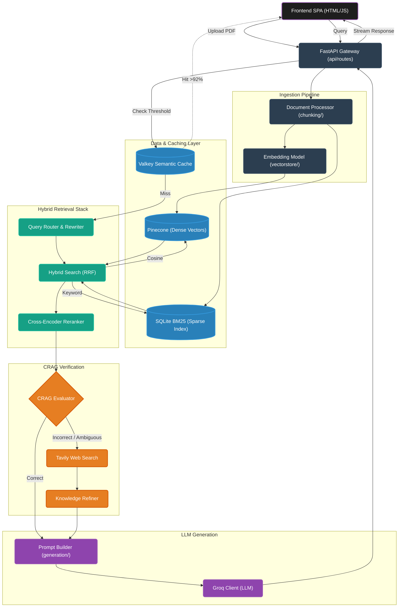

# Enterprise Corrective RAG (CRAG) System

A production-ready Corrective Retrieval-Augmented Generation (CRAG) system built with FastAPI, Groq, Pinecone, and Valkey. 

This project implements a highly advanced retrieval funnel that combines hybrid dense/sparse search, Reciprocal Rank Fusion (RRF), cross-encoder reranking, and an LLM-based evaluator that falls back to live web search (Tavily) when local document context is incorrect or ambiguous.

## Key Features

- **Hybrid Retrieval:** Fuses Dense vectors (Pinecone) with Sparse keyword search (SQLite-backed BM25) for high recall.
- **Cross-Encoder Reranking:** Re-scores candidates by passing the query and chunk simultaneously through a neural network for extreme precision.
- **Valkey Semantic Caching:** Bypasses the entire retrieval/LLM pipeline for repeat or semantically similar questions (≥92% cosine similarity) using Valkey's HNSW index, resulting in sub-50ms response times.
- **Corrective RAG (CRAG) Pipeline:** Automatically evaluates retrieved context. If local context is missing or incorrect, it falls back to **Tavily Web Search** to refine and fetch missing knowledge.
- **Observability Built-in:** Tracks millisecond-level latency across all stages (sanitization, cache lookup, BM25, rerank, generation).
- **Vanilla JS Frontend:** A lightweight, zero-build UI featuring citation tracing, evaluation badges (e.g., `CRAG: Correct`, `cache hit (98%)`), and streaming responses.

---

## Architecture Diagram



## UI & Features Showcase

The frontend provides a clean, zero-build vanilla JS interface with deep insights into the retrieval and evaluation process.

**CRAG Evaluation & Citations**  
*The system traces exact chunks and displays the "CRAG: Correct" badge when the LLM evaluator verifies the retrieved context.*


**Valkey Semantic Caching**  
*Repeat or semantically similar questions instantly trigger a cache hit, bypassing the LLM entirely for sub-50ms latency.*


**Document Management & Chat Interface**  
*Upload documents, view chunk counts, and interact with the hybrid-search RAG assistant.*


## The 5-Layer Retrieval Funnel

The system utilizes a multi-layered funnel to progressively narrow down the most relevant information before passing it to the CRAG Evaluator.

### Pre-Retrieval
* **Sanitization:** Strips injection patterns and truncates extreme query lengths.
* **Semantic Cache (Valkey):** Instant response if the query vector matches a previous cache entry above the 92% similarity threshold.

### Layer 1: Dual Retrieval (`TOP_K=10`)
Two independent retrievers run in parallel to fetch top candidates:
* **BM25 (Keyword):** Excels at exact word matching, term frequency, specific names, and code symbols.
* **Semantic (Pinecone):** Excels at conceptual matches and paraphrased questions using embedding cosine similarity.

### Layer 2: Reciprocal Rank Fusion (`RRF_K=60`)
Merges the two candidate lists into a single ranked list. Documents found by BOTH retrievers naturally bubble to the top without manual weight tuning. 
*Formula: `rrf_score(d) = Σ [1 / (k + rank(d))]`*

### Layer 3: Top-K Filter (`RRF_TOP_K=20`)
Truncates the fused list down to 20 candidates to preserve computational resources for the expensive reranking phase.

### Layer 4: Cross-Encoder Reranking (`FINAL_TOP_K=5`)
Uses `ms-marco-MiniLM-L-6-v2` to read the full query alongside each chunk simultaneously. This neural forward pass achieves massive precision gains over standard bi-encoders. Keeps only the top 5 highest-scoring chunks.

### Layer 5: CRAG Evaluation & Generation
* **Evaluation:** The CRAG Evaluator grades the final 5 chunks against the user's prompt.
* **Correction:** If graded "Incorrect", Tavily Web Search fetches accurate data, which is filtered by the Knowledge Refiner.
* **Generation:** Groq LLM synthesizes the finalized (and potentially corrected) context into a grounded response.


## Project Structure

```text
api/                 # FastAPI routes, schemas, and middlewares (Rate Limiting, Auth)
chunking/            # Document processing and base text chunkers
config/              # pydantic-settings and structured logging setup
frontend/            # Zero-build vanilla HTML/JS single-page application
generation/          # Prompt building and Groq LLM client orchestration
pipeline/            # CRAG Graph orchestrator and query/ingest pipelines
retrieval/           # BM25, Semantic, RRF, Cross-encoder, and Tavily implementations
utils/               # Valkey client, semantic cache, observability, and text cleaners
vectorstore/         # Pinecone vector store wrapper and sentence-transformer embedder
start.bat            # Background process launcher for Windows
```

## Quick Start

### 1. Clone and Install

```PowerShell
python -m venv venv
.\venv\Scripts\Activate.ps1
pip install -r requirements.txt
```

### 2. Configure Environment

Copy `.env.example` to `.env` and fill in your keys:

```text
GROQ_API_KEY=your_key
PINECONE_API_KEY=your_key
TAVILY_API_KEY=your_key

# Tunable RAG Parameters
TOP_K=10
RRF_K=60
RRF_TOP_K=20
FINAL_TOP_K=5
```

### 3. Run the Application
Ensure you have Valkey (or Redis Stack) running locally on port `6379`, then execute the bundled launcher script which manages both the FastAPI backend and Python HTTP frontend:

```PowerShell
.\start.bat
```
The browser will automatically open to `http://localhost:3000`.

## API Usage Example

```PowerShell
$apikey = "my-secret-key-123"
$query = @{ query = "What are the key skills mentioned in the resume?" } | ConvertTo-Json

Invoke-RestMethod -Uri "http://localhost:8000/api/v1/query" `
    -Method Post `
    -Headers @{
        "X-API-Key" = $apikey
        "Content-Type" = "application/json"
    } `
    -Body $query
```
